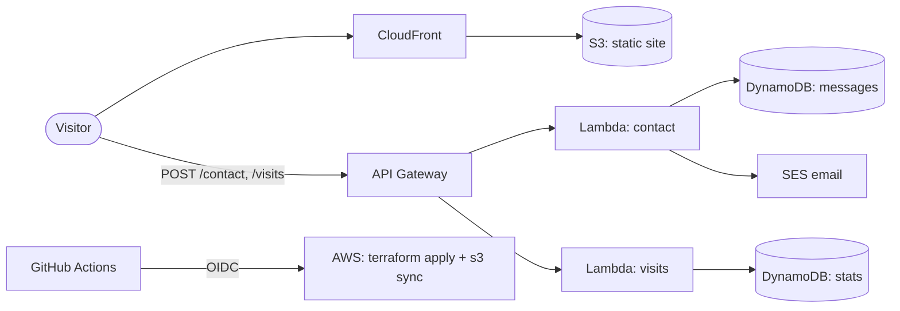

# Amjad Tleib | Portfolio

My personal portfolio site, with About, Work Experience, Projects and Contact sections, plus a serverless backend and fully automated AWS infrastructure.

**Live site:** https://PLACEHOLDER-your-domain.com

## Tech stack

| Layer | Tech |
|---|---|
| Frontend | Next.js (static export), React, TypeScript, Tailwind CSS |
| Hosting | Amazon S3 + CloudFront (Origin Access Control), optional Route 53 + ACM |
| API | API Gateway (HTTP API) + AWS Lambda (Node.js 22, TypeScript) |
| Data | DynamoDB (contact messages, visitor counter), SES (email notifications) |
| Infrastructure as code | Terraform (S3 remote state with native locking) |
| CI/CD | GitHub Actions with OIDC (no long-lived AWS keys) |
| Testing | Vitest + Testing Library (unit), Playwright (end-to-end) |

## Architecture



## Project structure

```
src/
  app/              Next.js pages (layout, home, 404)
  components/       UI sections and project cards
  data/site.ts      ALL site content: edit this to update the site
  lib/api.ts        Calls to the backend API
public/             Images, resume PDF
backend/            Lambda handlers (TypeScript, bundled with esbuild)
infra/bootstrap/    One-time setup: state bucket + GitHub OIDC roles
infra/main/         Everything else: S3, CloudFront, API, Lambda, DynamoDB, SES
tests/unit/         Vitest component tests
tests/e2e/          Playwright end-to-end tests
.github/workflows/  CI/CD pipeline
```

## Updating content

Everything on the page comes from `src/data/site.ts`. Each project has a `display`:

| `display` | Use for |
|---|---|
| `link` | Projects with a live site and/or GitHub repo |
| `screenshot` | Projects with an image (click to enlarge) |
| `text` | Work projects that can't be shown or linked |

## Local development

```bash
npm install
npm run dev            # http://localhost:3000, live reload while editing
npm run preview        # builds the exact static site that gets deployed, serves it at http://localhost:3000
npm run lint
npm run typecheck
npm test               # unit tests
npm run build && npm run test:e2e   # end-to-end (first time: npx playwright install chromium)

cd backend && npm install && npm test && npm run build
```

To use the real API locally, copy `.env.example` to `.env.local` and set `NEXT_PUBLIC_API_URL` to `terraform output api_url`.

## Deploying (one-time setup)

Prerequisites: an AWS account, the AWS CLI signed in (`aws configure` or SSO), and Terraform 1.10 or newer.

**1. Bootstrap** (creates the state bucket and the roles GitHub Actions uses):

```bash
cd infra/bootstrap
terraform init
terraform apply
```

If your AWS account already has a GitHub OIDC provider, import it first:
`terraform import aws_iam_openid_connect_provider.github arn:aws:iam::<ACCOUNT_ID>:oidc-provider/token.actions.githubusercontent.com`

**2. Add GitHub repository variables** (Settings → Secrets and variables → Actions → **Variables** tab).
These aren't secrets: OIDC means no AWS keys are stored in GitHub.

| Variable | Value |
|---|---|
| `AWS_REGION` | from bootstrap output (e.g. `us-east-1`) |
| `TF_STATE_BUCKET` | from bootstrap output |
| `AWS_PLAN_ROLE_ARN` | from bootstrap output |
| `AWS_DEPLOY_ROLE_ARN` | from bootstrap output |
| `NOTIFICATION_EMAIL` | where contact-form messages go |
| `DOMAIN_NAME` | optional, e.g. `amjadtleib.com` (needs a Route 53 hosted zone) |

**3. Push to `main`.** The pipeline tests everything, runs `terraform apply`, builds the site with the API URL, uploads it to S3 and invalidates CloudFront.

**4. Verify your email.** On the first apply, SES emails `NOTIFICATION_EMAIL` a verification link. Click it, or contact-form emails won't send.

## How the pipeline works

| Event | What runs |
|---|---|
| Pull request | Lint, type-check, unit tests, backend tests, e2e tests, `terraform plan` (read-only role; plan shown in the job summary) |
| Push to `main` | All of the above, then `terraform apply`, build, `s3 sync`, CloudFront invalidation |

Hashed build assets (`/_next/static`) are cached for a year; HTML and images are revalidated on every request so updates appear right away.

## Costs

Mostly within the AWS free tier for a personal site. Expect roughly $0–1/month (Route 53 hosted zone: $0.50/month, plus the domain if you use one).
